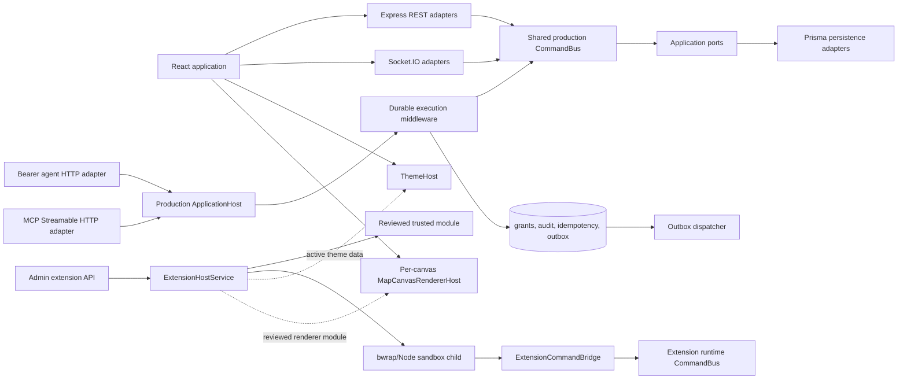

# Architecture migration: current executable state

## Purpose

CozyVTT is moving from a route- and Socket.IO-centred modular monolith toward
ports-and-adapters (hexagonal) boundaries with a small, controlled extension
runtime. This is an incremental migration, not a claim that every existing
path has already been replaced or that arbitrary plugins can run safely.

This document describes code that is present in this repository. It separates
the shipped execution model from planned work so it can be used for design and
operational decisions without overstating the application.

## Topology

The important distinction is intentional: the production `ApplicationHost`
wraps the shared core `CommandBus`, while the installed-extension runtime owns
its own registry and command bus. They share concepts and durable policy, but
they are **not yet one universal command host**.

## What ships now

### Core commands and transport boundaries

`productionCommandBus` is the central registry for the migrated core write
use cases. REST and Socket.IO adapters dispatch it for map and token work,
scene walls/fog/lights, initiative, chat and dice, campaigns and invitations,
assets, characters, content-library actions, and administrative mutations.
Those adapters retain their public wire contracts, recipient filtering, and
transport-specific ingress checks.

`productionApplicationHost` derives a catalog from that same registered core
command set and delegates to the exact handlers. Its command metadata carries
an identifier, version, risk, permissions, idempotency/outbox settings, and
descriptive input/output schemas. It is the protected façade used by the core
agent HTTP command route.

Read/query paths are not a corresponding universal query host. Many remain
scoped REST, Socket.IO, or repository read adapters, and command metadata is
not a replacement for every route's existing validation. In particular, most
interactive REST/Socket mutations currently enter `productionCommandBus`
directly rather than traversing `productionApplicationHost`.

### Durable protected execution

For calls with `origin: "AGENT"` or `origin: "EXTENSION"`, the application
host's durable middleware:

1. computes a canonical SHA-256 input digest and records value-free audit
   decisions;
2. requires an extension identity and an exact durable grant for every
   command permission;
3. registers and completes a durable idempotency key when the command is
   idempotent;
4. executes the protected persistence, idempotency completion, and outbox
   enqueue in the configured unit of work; and
5. creates an `application.command.executed.v1` outbox event for non-read
   host commands, then records execution or failure.

Prisma adapters persist grants, audit entries, idempotency records, and outbox
events. The production server starts an outbox dispatcher outside tests; its
currently registered consumer logs successful delivery. It has polling,
claiming, retry, and dead-letter mechanics, but it is not yet an external
event-integration system.

This transaction/outbox guarantee applies to protected `ApplicationHost`
dispatches. It must not be inferred for every legacy/direct `CommandBus`
transport path.

### Agent control plane and human confirmation

`/api/agent` is a narrow bearer-token HTTP adapter. An authenticated campaign
member can issue a campaign-scoped credential, list it, and revoke it. The
plaintext credential is returned only at issuance; persistence stores a
SHA-256 hash. Credential use is denied if its delegated user no longer belongs
to the campaign.

Core agent commands are discovered and executed through
`productionApplicationHost`; they are campaign-scoped and need matching
durable grants. Write commands require an `Idempotency-Key`. An agent may
create a pending confirmation, but only the delegated user's authenticated
session can approve or deny it. A successful approval produces a one-time,
five-minute receipt bound to the credential, delegated user, campaign,
extension, command, and canonical input digest.

The route can also list and invoke active extension tools through the extension
bridge. That bridge has separate runtime bindings and policy/audit
adapters, so it is not a general escape hatch to arbitrary REST, Socket.IO,
database, shell, or network access.

`/api/mcp/campaigns/:campaignId` is a Streamable HTTP MCP adapter over those
same protected boundaries. It authenticates the same hash-only bearer
credential on every request, filters tool discovery by exact campaign grants,
exposes the finite production query catalogue as read tools, and dispatches
core/extension writes through their existing hosts. Confirmation remains a
separate human action in CozyVTT; the MCP client can only submit the resulting
one-time receipt. `MCP_ALLOWED_HOSTS` can additionally restrict exact HTTP Host
values at the deployment edge.

The Profile UI exposes credential issuance/list/revocation and the pending
confirmation inbox. It never displays stored credential hashes or raw command
input; the receipt returned after approval is intentionally shown once so it
can be relayed to the waiting agent.

### Extension lifecycle

`ExtensionHostService` persists package installation state and supports
discovering local packages, install, activate, deactivate, uninstall, and
durable grant administration. `/api/admin/extensions` is protected by session
authentication and platform-admin authorization. Installation accepts a local
catalogue package ID—not a filesystem path or uploaded archive—and supports
`trusted` or `sandboxed` mode.

Trusted packages are imported in-process only after real-path/checksum checks,
an exact id/version/checksum allowlist, and signature verification. The shipped
review verifier is HMAC-based (`TRUSTED_EXTENSION_REVIEW_KEY`); deployments can
provide a different verifier. Missing trust configuration is deny-all.

Sandboxed packages are rechecked and invoked as short-lived Node children
under bubblewrap. They use a versioned NDJSON request/response protocol with a
read-only `/package`, temporary work directory, disabled network namespace,
Node read permission restricted to the package, and time/memory/output and
concurrency limits. Malformed output, timeout, or child failure ends that
invocation without taking down the VTT server.

At server startup, configured packages are rehydrated before the HTTP listener
opens. A bad package is logged and leaves the base VTT available. Rehydration
re-activates persisted active installations; it is lifecycle restoration, not
a persistent worker supervisor or a user-facing restart facility.

### Renderer, themes, and runtime UI

The map renderer is a per-`MapCanvas` host with stable terrain, token, and
overlay layer contracts. Registration, replacement, detach, and invalidation
are local to a canvas. Active trusted local packages may contribute a reviewed,
self-contained browser module. The package checksum is revalidated before the
module is served; the frontend imports it through a versioned API that owns and
disposes every registered/replaced layer. Sandboxed installations do not expose
renderer modules.

`ThemeHost` validates versioned semantic palettes and contrast. After login,
`ThemeSyncBridge` loads authenticated active theme contributions from
`GET /api/extensions/contributions`, validates complete data-only token sets,
and registers them with the current theme host. Extension lifecycle actions
emit a browser refresh event so the contribution loader can refresh safely.
Partial palettes and arbitrary CSS variables are rejected.

The Admin Extensions screen lists the local package catalogue and persisted
installations, performs trusted/sandboxed lifecycle actions, and lists,
creates, and revokes grants with trust/risk copy. This is a control plane, not
a marketplace. Active validated extension themes now appear in the ordinary
theme picker alongside built-in presets and use the same live-preview and
preference persistence path.

### Map aggregate concurrency

Every mutable `Map` row has an integer `revision`. Map lifecycle, token,
movement, walls, fog, lights, initiative-token, and spirit-token application
adapters update with `WHERE id = ? AND revision = ?` and atomically increment
the revision. When two commands read the same aggregate revision, PostgreSQL
accepts exactly one write; the other becomes a stable conflict instead of
silently replacing JSON written by the winner. REST adapters return `409` and
Socket.IO adapters request a refresh/retry. Maintenance/session restoration
writes increment the revision as well so later commands cannot reuse a stale
snapshot.

## Boundary rules

1. **Use commands for mutations.** New externally reachable mutations should
   enter an application command, not recreate business rules in a route or
   call a privileged internal HTTP endpoint.
2. **Keep queries explicitly scoped.** The production query host exposes a
   finite read-only catalogue and each adapter enforces campaign/tenant
   authorization. New reads must join that catalogue rather than being
   presented as write-command capabilities.
3. **Treat declared permissions as requests, not authority.** A manifest or
   tool descriptor does not grant access; protected execution checks durable,
   campaign-scoped grants.
4. **Keep agent attribution value-free.** Store identity, delegation,
   campaign, extension/command, digest, decision, and reason—not plaintext
   credentials, raw command input, or result payloads.
5. **Do not import untrusted packages into the server.** Only reviewed trusted
   modules run in-process. Sandboxed packages remain process-isolated.
6. **Keep UI semantics theme-driven.** UI components use semantic tokens;
   extension themes are validated data rather than arbitrary style injection.

## Remaining limits and non-goals

- The core and installed-extension command runtimes are separate. A future
  shared command/query host needs a deliberate binding and authorization model
  rather than an implicit bridge between their buses.
- The agent surface has an explicit read-only query catalogue and MCP endpoint.
  A remote package store/marketplace is intentionally not part of the design;
  package upgrade/rollback and extension migration workflows remain absent.
- Host metadata schemas are catalog/documentation metadata for many core
  commands; they are not yet one strict schema implementation reused by every
  transport.
- Durable middleware/outbox coverage is currently the protected host path,
  not every legacy/direct core transport command.
- The sandbox is Linux/bubblewrap/Node dependent. The supplied Node 24 Docker
  images include bubblewrap and the Compose services have a verified
  unprivileged execution path. They intentionally use `seccomp=unconfined`
  because Docker's default profile blocks the user namespace bubblewrap needs,
  while retaining `no-new-privileges`; operators must explicitly accept that
  tradeoff or run the sandbox separately. There is still no cgroup CPU quota,
  persistent worker process, per-extension storage/network grant, automatic
  child restart loop, or rich operational telemetry.
- Executable browser rendering is limited to explicitly trusted local packages;
  it is not available to sandboxed packages. There is no frontend code sandbox,
  arbitrary CSS contribution, route/component injection, or iframe plugin UI.

## Evidence and verification

The architecture is covered by focused tests including
`ApplicationHost.transaction.test.ts`, `productionApplicationHost.test.ts`,
durable-foundation persistence tests, outbox dispatcher/runtime tests,
extension host/route/sandbox tests, agent route tests, renderer host tests,
MCP protocol/HTTP tests, PostgreSQL map-revision races, and
ThemeHost/contribution-picker tests. A change is not considered migrated merely
because interfaces compile: it needs a production adapter path and behaviour,
authorization, and failure coverage.
