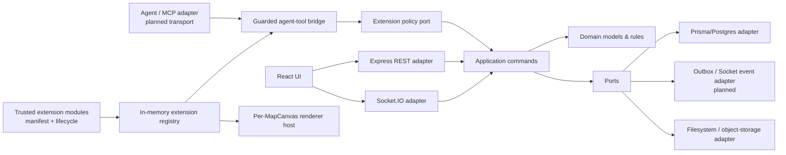
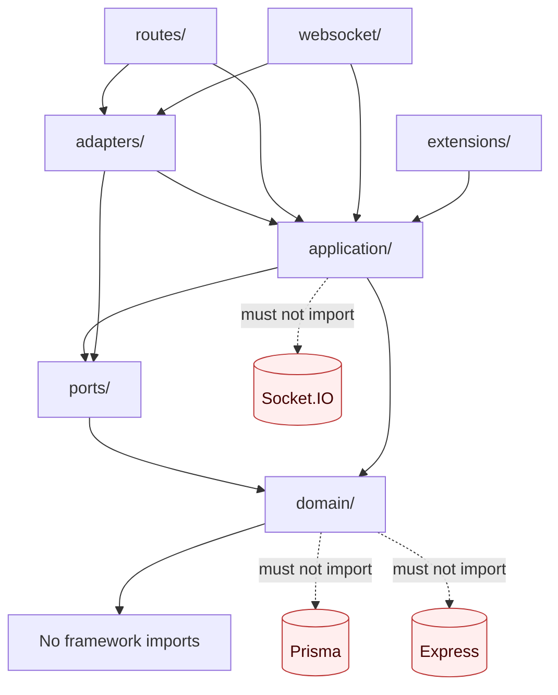
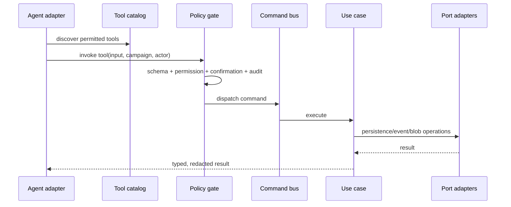

# Architecture migration: modular, agent-safe CozyVTT

## Purpose and current status

CozyVTT is being migrated from a route-and-socket-centred application toward a
**hexagonal (ports-and-adapters) core with a small extension microkernel**. The
goal is not a rewrite. Existing REST and Socket.IO clients remain supported
while behaviour moves, one use case at a time, behind explicit application
commands and ports.

This document is the migration contract. It distinguishes code that is
available now from work that must still happen before calling the system a
general runtime-plugin or agent platform.

## The architecture being introduced

### What is now executable

* `POST /api/campaigns/:campaignId/token-templates` retains its public REST
  contract, but is now an HTTP adapter. It validates the existing request,
  dispatches `token-template.create`, and writes through
  `TokenTemplateRepository`'s Prisma adapter.
* The command publishes a `token-template.created` domain event through a
  port. The current deployment selects a no-op publisher, so this introduces
  no unexpected Socket.IO behaviour.
* The existing `token.move.start`, high-frequency `token.move`, and
  `token.move.end` Socket.IO flow now dispatches `token.move.start`,
  `token.move.preview`, and `token.move.finalize` application commands. The
  commands own map scope, bounds checks, token control, spectator/spirit-layer
  rules, and the final persistence write; the socket handler remains the
  recipient-filtering and wire-compatibility adapter.
* Core map lifecycle REST writes—create, update, delete, and set-current—and
  `map.change` now dispatch map-lifecycle commands through their ports. Map
  token REST create, update, and delete operations similarly dispatch scoped
  token commands. The route and Socket.IO adapters retain their existing
  response/event shapes, filtered recipient broadcasts, and not-found/privacy
  behavior.
* `chat.message` and `dice.roll` now dispatch application commands as well.
  The commands own validation, cooldown/rate enforcement, user lookup,
  persistence, dice parsing, and creation of the dice audit message. Socket.IO
  remains responsible for campaign fan-out and the existing secret-roll
  visibility rules, preserving current event names and payloads.
* Scene editing writes—`wall:add`, `wall:remove`, `wall:update`,
  `walls:replace`, `fog:operation`, `light:add`, `light:remove`,
  `light:update`, and `lights:replace`—now dispatch scene commands through a
  `SceneMutationRepository`. Commands own map scope, role/door rules, fog
  mutation, limits, and JSON-field persistence. The WebSocket adapters retain
  legacy schema validation, rate limits, request/reconnect reads, and the
  DM-versus-player fog broadcast filter. The REST wall, light, fog-operation,
  and dedicated dynamic-lighting-toggle endpoints dispatch these same commands
  after preserving their existing HTTP validation, status/error bodies,
  campaign checks, and broadcasts.
* Initiative mutations—add, remove, set, roll, reorder, start, advance, and
  end—now dispatch application commands. The commands own DM authorization,
  map/token lookup, combat-state transitions, initiative-value persistence,
  and initiative-roll calculation. The socket adapter preserves the full
  `initiative.state` payload and the legacy `dice.rolled` then
  `initiative.state` ordering for a rolled initiative. `initiative.request_state`
  remains a read-only adapter query.
* `BlobStorage` and its filesystem adapter establish the storage boundary; no
  upload flow has been migrated to it yet.
* The extension package validates versioned manifests, compatibility,
  capability declarations, permission declarations, command/tool references,
  duplicate identifiers, and lifecycle transitions for **trusted in-process**
  modules.
* `MapCanvas` can receive a per-canvas `MapCanvasRendererHost`. Its terrain,
  token, and overlay layers are stable, versioned replacement points; runtime
  registrations cause the owning canvas to redraw. Without a supplied host,
  it creates an equivalent private host so existing callers retain behaviour.
* The guarded, transport-neutral `ExtensionCommandBridge` can enumerate active
  agent tools for a scoped principal and invoke an **allowlisted command
  binding**. It validates input/output schemas, checks an explicit policy
  grant, requires the declared confirmation level, rejects contradictory
  campaign input, recursively redacts secret-shaped output fields, and records
  value-free audit events. It is intentionally inert without a host-provided
  command binding and policy grant.

### What is intentionally not claimed yet

There is no production extension installer, persistent registry, extension
process/WASM sandbox, MCP/HTTP agent adapter, durable capability grant store,
durable audit store, transactional command-event outbox, or
extension-to-frontend bundle loader. The registry and bridge are therefore
tested in-process kernels, not an end-user plugin marketplace. A manifest
descriptor still cannot execute arbitrary extension code: it needs an
explicitly registered, host-reviewed command binding.

Likewise, a renderer host is an in-memory integration seam. It is supplied by
the map owner; it is not remotely controllable and does not load renderer code
from a plugin package. This is deliberate until the extension security model
exists.

## Dependency direction

The frontend rendering boundary mirrors this rule. The renderer kernel owns
ordering, compatibility, attachment, registration, and invalidation. The
product-specific `MapCanvasRendererContext` owns only a narrow current-frame
view of canvas/map/viewport state and safe callbacks. Renderer extensions must
not reach into React component closures, Zustand stores, DOM query selectors,
or socket singletons.

## Extension and agent model

An agent adapter should receive a catalog of application tools, not raw HTTP
or socket access. The current bridge implements that policy boundary in memory:
each active tool resolves through a pre-registered command factory, and the
bridge authorizes the principal in campaign scope before dispatch. A production
MCP or HTTP adapter is intentionally still absent.

The manifest's `requiredPermissions` are a request by an extension, not a
grant. Tool permissions must include the command's requirements. High-risk
tools cannot use `confirmation: never`. The bridge independently checks a
scope-bound `ExtensionPolicyPort` grant and confirmation receipt; its current
in-memory policy/audit adapters are deliberately not a production identity or
audit system.

## Renderer extension points

| Stable layer id | Surface | Default behaviour | Safe extension action |
|---|---|---|---|
| `cozyvtt.map.terrain` | terrain | Map, grid, fog, spirit artwork | register another ordered terrain layer or replace explicitly |
| `cozyvtt.map.tokens` | tokens | Map tokens and drag state | register another ordered token layer or replace explicitly |
| `cozyvtt.map.overlay` | overlay | Interaction and visual overlays | register another ordered overlay layer or replace explicitly |

Layer registration validates its contract version, identifier, and ordering.
Registration/swap/disposal invalidate only the affected canvas surface. Hosts
are per canvas, so a renderer must never assume one global map or bind a host
to more than one canvas.

## Invariants (non-negotiable)

1. **Compatibility first.** A migrated REST or Socket.IO action preserves its
   validation, authorization, status codes, response/event shape, and ordering
   unless the API is explicitly versioned.
2. **Domain/application code stays transport-free.** No Express request,
   response, Socket.IO socket, Prisma client, filesystem path, or browser API
   may cross into domain models or application use cases.
3. **All mutation paths converge.** UI, REST, Socket.IO, import jobs, CLI, and
   agents invoke the same command/use case; an adapter never recreates a
   mutation by issuing a privileged internal HTTP request.
4. **Authorization is not a manifest field.** Every command enforces actor and
   campaign scope through a policy/authorization boundary. Manifest-declared
   permissions are the minimum requested capability only.
5. **Agent operations are attributable.** The current bridge records
   principal, campaign, extension/tool/command identifiers, outcome, reason,
   timestamp, and input keys without storing input values or results. Before
   general agent writes are enabled, this must become durable and additionally
   record delegated human identity, an input digest, and the authorization
   decision.
6. **Failure is contained.** A failed plugin lifecycle action leaves the
   registry unmodified; failed event publication must not silently create an
   invisible split-brain state; a failed renderer layer must not prevent core
   map layers from drawing.
7. **Renderer state is scoped.** A renderer receives the documented frame
   context and requests redraw through its host. It must not retain a canvas
   or context after detach/unmount, mutate core map state during draw, or run
   network requests in a frame callback.
8. **Theme semantics stay separate from features.** Components consume
   semantic theme tokens. Themes—including dark themes—are data/manifests, not
   separate UI branches or hard-coded colour literals.
9. **Untrusted code is never `import()`ed in the server process.** Until a
   sandbox and resource limits exist, only reviewed first-party/trusted modules
   may use the extension lifecycle interfaces.

## Migration phases

### Phase 0 — foundation (complete first slices)

Define ports, domain models, command bus, migrated token-template REST and
token-movement, chat, dice, scene-editing, and initiative Socket.IO write
paths; manifest validation/lifecycle contracts; a guarded in-process agent
bridge; BlobStorage; and a per-canvas renderer host. Keep all existing API
behaviour and test the seams.

### Phase 1 — application spine (in progress)

Migrate every mutation, prioritised by shared use:

1. complete remaining map/token mutations and migrate the read/query paths
   needed by other transports while preserving scene request/reconnect
   semantics;
2. campaigns/membership/characters/assets/sessions;
3. import/export and admin configuration.

For each, add an application command, domain input/output types, repository or
service ports, existing Prisma/filesystem/Socket.IO adapters, and contract
tests against today's REST and websocket behaviour. Read-only queries may use
a separate query port but must remain tenant/campaign-scoped.

### Phase 2 — durable events and policy

Replace the no-op publisher with a transactionally safe outbox and event
delivery adapters. Replace in-memory extension policy/audit adapters with
durable actor grants and value-free audit persistence. Add delegated identity,
input digests, idempotency keys, optimistic versioning where appropriate,
rate/concurrency limits, and command input/output schemas shared by all
adapters.

### Phase 3 — controlled agent adapter (bridge complete; transport pending)

Expose a narrow MCP/HTTP/UI adapter over the existing filtered bridge. It must
establish trusted principals and attributable confirmation receipts outside
model-supplied input; use durable grants/audit from Phase 2; provide dry-run or
preview where viable; enforce quotas and human-visible activity. Start with
read tools and explicitly confirmed low-risk writes; never expose arbitrary
database, HTTP, shell, or socket capabilities.

### Phase 4 — trusted extension host

Add package discovery, signature/allowlist policy, persistent install state,
dependency resolution, migration hooks, frontend contribution manifests, and
admin activation controls. Bind declared commands only to reviewed handlers,
validate schemas at the boundary, and expose only permitted agent tools.

### Phase 5 — sandboxed third-party extensions

Run third-party code outside the main server process (WASM/process/container
sandbox), with a versioned RPC protocol, timeout/memory/CPU limits, network
egress policy, scoped storage, kill/restart controls, upgrade/rollback, and
observability. Only after this phase should external marketplace-style plugins
be considered.

### Phase 6 — modular renderer and themes

Move the renderer host ownership to the campaign workspace integration layer,
give trusted extensions a controlled registration bridge, add per-layer error
isolation/telemetry, and versioned context migration. Publish theme manifests
on a semantic token contract; validate contrast and missing tokens before
activation and support user/instance defaults plus optional system preference.

## Test gates for every phase

* backend TypeScript build and focused Jest suite;
* frontend typecheck, build, and focused Vitest suite;
* REST and Socket.IO compatibility tests for migrated actions;
* authorization and cross-campaign isolation tests;
* lifecycle failure, duplicate, compatibility, and cleanup tests;
* renderer order, swap, unmount, redraw, and throwing-layer containment tests;
* an end-to-end campaign smoke test using exported/imported sample data.

No phase is complete simply because the interfaces compile. A seam is accepted
only when an existing production path traverses it and its failure/permission
behaviour is covered by tests.
