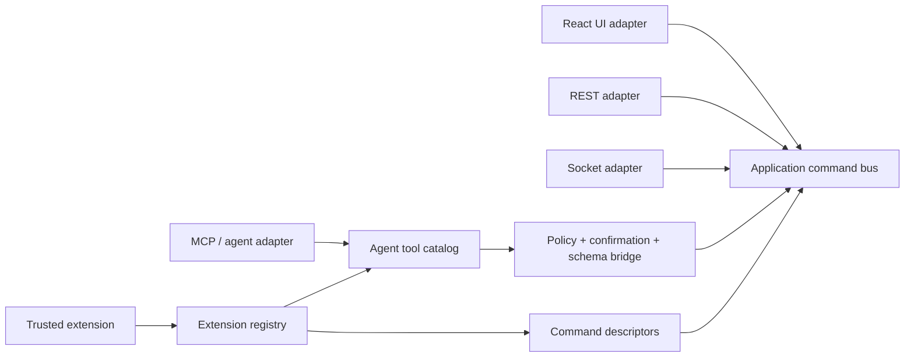

# Extension and agent contract — first slice

This document defines CozyVTT's first stable extension boundary. It is a
small, versioned microkernel inside the existing modular monolith—not a claim
that arbitrary third-party JavaScript can safely execute in the backend today.

The canonical TypeScript contracts live in
`backend/src/extensions/`. They are deliberately backend-local while the
repository has no shared package build. A future published contract package
must be generated from these schemas or adopted with a coordinated backend and
frontend build change; do not manually copy the types into a new package.

## Boundary

Extensions describe **capabilities** and **application commands**. Their
manifest never contains Express route paths, HTTP methods, Socket.IO event
names, Prisma models, SQL, or renderer implementation references.



The key rule for agents is simple: an agent tool's `commandId` identifies an
application command. It does not identify a request endpoint. The agent-facing
bridge resolves the active descriptor, obtains the caller's grants and
approval, validates JSON input, and dispatches an allowlisted command factory
through the same command bus as a UI or socket adapter.

## Guarded agent-tool bridge

`extensions/bridge/` is a transport-neutral service—not an HTTP or MCP route.
It accepts a trusted principal and campaign scope from an adapter, then:

1. exposes only active tools with a matching, explicit extension grant;
2. requires a pre-registered command binding for every descriptor;
3. validates descriptor input against its portable JSON schema and rejects a
   supplied `campaignId` that conflicts with the authorized scope;
4. requires attributable confirmation for `always`, `when-risky` non-read, and
   all high-risk tools;
5. validates handler output, recursively redacts secret-shaped result fields,
   and emits value-free audit evidence.

The bridge has no Express, Socket.IO, Prisma, or raw extension-handler access.
`InMemoryExtensionPolicy` and `InMemoryAgentToolAudit` are safe local/test
adapters; deployments without grants use the default-deny policy. A future MCP
adapter must establish the principal and confirmation receipt outside of the
model's untrusted tool arguments.

## Manifest contract

`ExtensionManifest` is validated with Zod before lifecycle code is invoked.
The current manifest version is `1.0` and the current extension API version is
`1.0.0`.

```ts
const manifest = {
  manifestVersion: '1.0',
  id: 'cozyvtt.lantern-tools',
  name: 'Lantern Tools',
  version: '1.0.0',
  description: 'Campaign note tools.',
  compatibility: {
    extensionApi: '^1.0.0',
    cozyVtt: '^1.1.0',
  },
  capabilities: ['commands', 'agent-tools'],
  permissions: ['campaign.read', 'campaign.write'],
  commands: [{
    id: 'campaign.add-note',
    version: '1.0.0',
    title: 'Add campaign note',
    description: 'Adds a note to a campaign.',
    inputSchema: { type: 'object', properties: { campaignId: { type: 'string' } } },
    outputSchema: { type: 'object', properties: { noteId: { type: 'string' } } },
    requiredPermissions: ['campaign.write'],
    idempotent: false,
  }],
  agentTools: [{
    id: 'campaign_add_note',
    title: 'Add campaign note',
    description: 'Create a note after user confirmation.',
    commandId: 'campaign.add-note',
    requiredPermissions: ['campaign.read', 'campaign.write'],
    risk: 'low',
    confirmation: 'when-risky',
  }],
};
```

### Compatibility

Both `compatibility.extensionApi` and `compatibility.cozyVtt` use the supported
semver grammar: an exact version, `*`, caret (`^`), tilde (`~`), comparator
sets such as `>=1.1.0 <2.0.0`, and `||` alternatives. The registry rejects a
manifest that does not support the host before calling `onInstall`.

### Capabilities and permissions

Capabilities state what sort of contribution an extension offers:

- `commands`, `agent-tools`
- `scene-layers`, `renderers`, `themes`, `game-systems`
- `importers`, `exporters`

Permissions are explicit, finite declarations such as `campaign.read`,
`maps.write`, `tokens.write`, `assets.write`, `themes.write`, and
`network.fetch`. A command and an agent tool may only request permissions that
the manifest itself declares. An agent tool must declare every permission of
the command it dispatches. A declaration is not a grant: user, campaign, and
service-identity policy checks still happen at dispatch time.

High-risk agent tools cannot use `confirmation: 'never'`.

## Lifecycle and safety

`ExtensionRegistry` has four lifecycle stages:

1. `install`: parse manifest, check compatibility and all descriptor conflicts,
   then call `onInstall`.
2. `activate`: call `onActivate`; only on success are commands and agent tools
   discoverable.
3. `deactivate`: call `onDeactivate`; on success descriptors disappear.
4. `uninstall`: only allowed after deactivation, then calls `onUninstall`.

Duplicate extension IDs and command declarations fail before hooks run. An
activation failure leaves an extension installed but inactive, so none of its
tools are exposed. A deactivation failure leaves it active and still exposed;
that is safer than falsely advertising an unavailable extension. Concurrent
lifecycle transitions for the same extension are rejected as `BUSY`.

This registry is an in-memory trusted-module kernel. Production installation of
untrusted packages remains a later hardening milestone: backend code must run
in WASM/WASI or an isolated worker/container; frontend extensions must run in a
sandboxed iframe; networking must be default-deny; and package signatures,
durable storage, audit events, and policy grants must be added before exposing
the feature to third parties.

## Next integration steps

1. Wire durable policy grants and audit storage, then add a narrow MCP adapter
   that establishes principals and confirmation receipts.
2. Migrate further actions—starting with token movement—so REST, Socket.IO,
   React UI, and test adapters dispatch the same application command.
3. Add idempotency and transactional outbox ports around command dispatch.
4. Add renderer and scene-layer ports; retain Canvas2D as the first adapter.

The bridge is intentionally inert until a host registers a command binding and
provides an explicit policy grant. It is not permission to invoke existing
transport handlers directly.
